<!-- ============================== HEADER ============================== -->
<p align="center">
  
</p>

<p align="center">
  <a href="https://git.io/typing-svg">
    
  </a>
</p>

<p align="center">
  <a href="https://www.linkedin.com/in/1huy2409/"></a>
  <a href="mailto:nhathuy2409@gmail.com"></a>
  <a href="https://www.facebook.com/nguyenhuyone"></a>
  
</p>

<br/>

## `❯ whoami`

I'm a **Software Engineer from Vietnam 🇻🇳** working at the intersection of *code* and *systems*.
I build backend services, run them on **AWS**, and treat **AI as a first-class part of my engineering workflow** — shipping faster without cutting corners.
Heading toward **Solution Architect**: turning business problems into reliable, cost-aware, well-reasoned cloud architectures.

```yaml
apiVersion: engineer/v1
kind: Profile
metadata:
  name: 1Huy
  region: ap-southeast-1   # Đà Nẵng, Vietnam
spec:
  role: Software Engineer
  target: Solution Architect
  focus:
    - Backend & distributed systems
    - Cloud infrastructure on AWS
    - AI-augmented software delivery
  principles:
    - "Design for failure, optimize for change"
    - "Measure first, then scale"
    - "Every architecture is a set of trade-offs — write them down"
  education: Da Nang University of Technology (DUT)
```

<br/>

## `❯ ls ./capabilities`

<table>
  <tr>
    <td width="33%" valign="top">
      <h3 align="center">⚙️ Engineering</h3>
      <ul>
        <li>RESTful & event-driven backends with <b>Node.js / NestJS</b></li>
        <li>Data modeling with <b>PostgreSQL</b>, <b>MySQL</b>, <b>MongoDB</b></li>
        <li>Clean architecture, testable modules, clear API contracts</li>
      </ul>
    </td>
    <td width="33%" valign="top">
      <h3 align="center">☁️ Cloud & Infra</h3>
      <ul>
        <li>Deploying & operating workloads on <b>AWS</b></li>
        <li>Containers with <b>Docker</b>, automated <b>CI/CD</b> pipelines</li>
        <li>Networking, security, observability & cost awareness</li>
      </ul>
    </td>
    <td width="33%" valign="top">
      <h3 align="center">🤖 AI-Augmented</h3>
      <ul>
        <li>AI agents for coding, review, refactoring & docs</li>
        <li>Prompt / context engineering for high-quality output</li>
        <li>Automating repetitive work so focus stays on design</li>
      </ul>
    </td>
  </tr>
</table>

<br/>

## `❯ cat stack.yml`

<table>
  <tr>
    <td align="center" width="140"><code>languages</code></td>
    <td></td>
  </tr>
  <tr>
    <td align="center"><code>backend</code></td>
    <td></td>
  </tr>
  <tr>
    <td align="center"><code>data</code></td>
    <td></td>
  </tr>
  <tr>
    <td align="center"><code>cloud_devops</code></td>
    <td></td>
  </tr>
  <tr>
    <td align="center"><code>tooling</code></td>
    <td></td>
  </tr>
  <tr>
    <td align="center"><code>ai</code></td>
    <td>
      
      
      
      
    </td>
  </tr>
</table>

<br/>

## `❯ cat architecture-principles.md`

| Pillar | What it means to me |
|---|---|
| 🔒 **Security** | Least privilege by default, secrets never in code, encrypt in transit & at rest |
| 🛡️ **Reliability** | Multi-AZ thinking, health checks, retries with backoff, graceful degradation |
| ⚡ **Performance** | Cache where it matters, async where possible, profile before optimizing |
| 💰 **Cost** | Right-size resources, pay for what you use, make cost visible |
| 🔧 **Operability** | IaC, automated pipelines, logs/metrics/traces from day one |
| 🌱 **Evolvability** | Clear boundaries, documented decisions (ADRs), easy to change later |

<br/>

## `❯ git log --stats`

<p align="center">
  
  
</p>

<p align="center">
  
</p>

<p align="center">
  
</p>

<br/>

## `❯ ping 1huy`

Always happy to talk about **system design, cloud architecture, and how AI is changing the way we build software**.
Reach out via the links above — or drop a ⭐ on something you find useful.

<!-- ============================== FOOTER ============================== -->
<p align="center">
  
</p>
